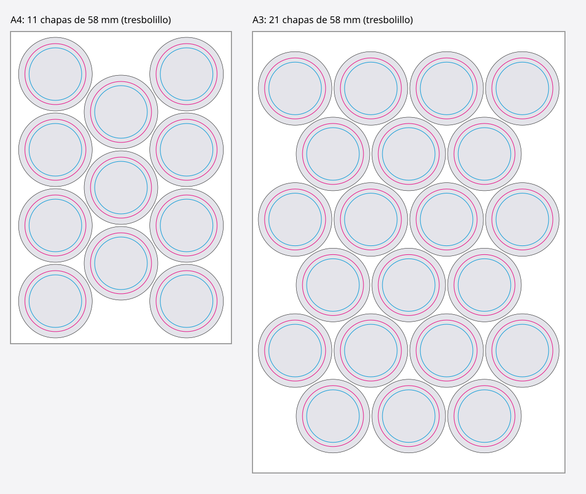

# Chapas y tazas: app para Canva

Una app que funciona dentro del editor de Canva y crea hojas listas para
imprimir con tus fotos recortadas en la forma del producto:

- **Chapas de 58 mm** en hojas **A4** (11 por hoja) o **A3** (21 por hoja),
  colocadas al tresbolillo para aprovechar el papel.
- **Tazas** de **20 × 9,5 cm** (las medidas se pueden cambiar).

Cada chapa o taza es una forma de Canva rellena con la foto, que funciona igual
que un marco. Haz doble clic para mover o ampliar la foto dentro del círculo, o
arrastra otra imagen encima para cambiarla. Los huecos sin foto quedan en gris,
listos para arrastrar imágenes.



## Qué hace

1. Eliges **Chapas** o **Tazas**.
2. En las chapas, eliges la hoja **A4** o **A3**. La app te dice cuántas
   caben.
3. Subes **una o varias fotos**. Si hay más fotos que huecos, crea las hojas
   que hagan falta.
4. Pulsas **Crear páginas**. La app añade al diseño páginas del tamaño exacto.

Opciones:

- **Repetir la primera foto en toda la hoja**: una hoja entera de la misma
  chapa.
- **Línea de corte**: contorno negro fino alrededor de cada círculo para
  recortarlo.
- **Guías de color**:
  - Chapas: el círculo **rosa** es la cara visible (58 mm) y el **azul** es la
    zona segura (50 mm), donde conviene dejar textos y caras.
  - Tazas: el rectángulo **azul** es el margen seguro (5 mm) y la línea
    **rosa** marca el centro del diseño.
  - Van agrupadas en cada página: **selecciona el grupo y bórralo antes de
    imprimir**.

### Medidas por defecto (chapa de 58 mm)

| Medida | Valor | Qué es |
|---|---|---|
| Círculo de corte | 70 mm | Lo que recortas del papel, con la parte que se dobla por detrás |
| Cara visible | 58 mm | Lo que se ve por delante |
| Zona segura | 50 mm | Donde no se curva la imagen |
| Margen de hoja | 5 mm | Borde que la impresora no imprime |
| Separación | 2 mm | Espacio entre círculos |

Cada máquina de chapas varía un poco: ajusta las medidas en **Medidas de la
chapa y la hoja**.

## Cómo probarla en tu Canva

Necesitas un ordenador con [Node.js](https://nodejs.org) 24 y una cuenta de
Canva.

1. Descarga esta carpeta e instala lo necesario:

   ```bash
   cd app-canva-chapas
   npm install
   ```

2. Arranca el servidor de desarrollo:

   ```bash
   npm start
   ```

   Se queda funcionando en `http://localhost:8080`.

3. Ve al [Portal de desarrolladores de Canva](https://www.canva.com/developers/apps)
   y pulsa **Create an app**. Es gratis.
4. En **App source → Development URL**, escribe `http://localhost:8080`.
5. Pulsa **Preview**. Se abre el editor de Canva con la app en el panel
   lateral.
6. Abre o crea cualquier diseño (por ejemplo, uno en blanco A4) y usa la app.
   Las páginas nuevas se añaden con su propio tamaño.

## Para imprimir

- Descarga como **PDF para impresión** a tamaño real (100 %, sin "ajustar a la
  página").
- **Tazas por sublimación**: muchas impresoras necesitan la imagen en espejo.
  Actívalo en las opciones de impresión de la impresora.

## Para desarrolladores

```bash
npm test           # pruebas
npm run lint:types # comprobación de tipos
npm run lint       # lint
npm run build      # versión para enviar a Canva (carpeta dist/)
```

- `src/lib/maquetacion.ts`: calcula cuántos círculos caben en la hoja y dónde,
  probando cuadrícula y tresbolillo.
- `src/lib/paginas.ts`: crea las formas de Canva (foto recortada, línea de
  corte y guías).
- `src/lib/imagenes.ts`: sube las fotos del ordenador a Canva.
- `src/intents/design_editor/app.tsx`: el panel de la app.

La app está construida con el
[kit oficial de inicio del Canva Apps SDK](https://github.com/canva-sdks/canva-apps-sdk-starter-kit).
